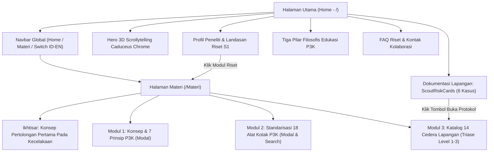

# BUKU PANDUAN PENGGUNA (USER MANUAL)
## Media Edukasi & Protokol Kesiapsiagaan Pertolongan Pertama Pada Kecelakaan (P3K) Berbasis Web

---

### Informasi Dokumen & Riset
- **Judul Penelitian**: *Pengaruh Edukasi P3K Berbasis Website dan Simulasi Terhadap Pengetahuan dan Keterampilan Anggota Pramuka Dalam Penanganan Kecelakaan di SMA Negeri 4 Singaraja*
- **Nama Sistem / Aplikasi**: **Scout Sigap P3K (Web Edukasi & Protokol Kesiapsiagaan P3K Pramuka)**
- **Peneliti & Pengembang**: **Made Candra Susanta**
  - *Mahasiswa Program Sarjana (S1) Keperawatan, STIKES Buleleng*
  - *Alumni Pradana Putra Ambalan Ken Arok – Ken Dedes, SMAN 4 Singaraja (Masa Bakti 2022–2023)*
- **Subjek Penelitian**: Anggota Gerakan Pramuka Ambalan Ken Arok – Ken Dedes SMAN 4 Singaraja
- **Status Akses**: Terbuka untuk Umum (*Open Access*), Bebas Biaya, Tanpa Sistem Registrasi/Paywall
- **Lisensi Konten**: Creative Commons Attribution-NonCommercial-ShareAlike 4.0 International (*CC BY-NC-SA 4.0*)
- **Versi Rilis Dokumen**: 1.0.0 (Tahun 2026)

---

## DAFTAR ISI
1. [Tentang Website](#1-tentang-website)
2. [Tujuan dan Manfaat Pembelajaran](#2-tujuan-dan-manfaat-pembelajaran)
3. [Standar Ilmiah & Landasan Medis](#3-standar-ilmiah--landasan-medis)
4. [Kebutuhan Perangkat & Akses Sistem](#4-kebutuhan-perangkat--akses-sistem)
5. [Peta Arsitektur & Struktur Antarmuka](#5-peta-arsitektur--struktur-antarmuka)
6. [Panduan Penggunaan Halaman Home (Beranda)](#6-panduan-penggunaan-halaman-home-beranda)
   - 6.1. [Navigasi Atas (Sticky Navbar)](#61-navigasi-atas-sticky-navbar)
   - 6.2. [Hero 3D Scrollytelling Interaktif](#62-hero-3d-scrollytelling-interaktif)
   - 6.3. [Profil Peneliti & Landasan Riset](#63-profil-peneliti--landasan-riset)
   - 6.4. [Dokumentasi Lapangan & Analisis Risiko Kepramukaan](#64-dokumentasi-lapangan--analisis-risiko-kepramukaan)
   - 6.5. [Tiga Pilar Filosofis Edukasi P3K](#65-tiga-pilar-filosofis-edukasi-p3k)
   - 6.6. [Tanya Jawab (FAQ) & Formulir Kolaborasi](#66-tanya-jawab-faq--formulir-kolaborasi)
7. [Panduan Penggunaan Halaman Materi & Protokol Klinis](#7-panduan-penggunaan-halaman-materi--protokol-klinis)
   - 7.1. [Akses dan Ikhtisar Pokok Materi P3K](#71-akses-dan-ikhtisar-pokok-materi-p3k)
   - 7.2. [Modul Konsep Dasar & 7 Prinsip P3K](#72-modul-konsep-dasar--7-prinsip-p3k)
   - 7.3. [Modul Standarisasi 18 Peralatan Kotak P3K](#73-modul-standarisasi-18-peralatan-kotak-p3k)
   - 7.4. [Katalog 14 Kasus Cedera Lapangan Berbasis Triase](#74-katalog-14-kasus-cedera-lapangan-berbasis-triase)
   - 7.5. [Fitur Progressive Disclosure Modal (SOP Lengkap)](#75-fitur-progressive-disclosure-modal-sop-lengkap)
8. [Panduan Fitur-Fitur Khusus](#8-panduan-fitur-fitur-khusus)
   - 8.1. [Fitur Dwi-Bahasa (Bilingual ID / EN)](#81-fitur-dwi-bahasa-bilingual-id--en)
   - 8.2. [Pencarian Cepat & Filter Triase](#82-pencarian-cepat--filter-triase)
   - 8.3. [Deep-Linking Antar Modul](#83-deep-linking-antar-modul)
   - 8.4. [Pintasan Keyboard (Keyboard Shortcut)](#84-pintasan-keyboard-keyboard-shortcut)
9. [Tabel Referensi Cepat Medis (Quick Reference Guide)](#9-tabel-referensi-cepat-medis-quick-reference-guide)
   - 9.1. [Daftar 18 Peralatan Kotak P3K](#91-daftar-18-peralatan-kotak-p3k)
   - 9.2. [Katalog 14 Cedera Lapangan & Tingkat Keparahan](#92-katalog-14-cedera-lapangan--tingkat-keparahan)
   - 9.3. [Metrik Tindakan Kritis Penyelamatan Jiwa](#93-metrik-tindakan-kritis-penyelamatan-jiwa)
10. [Pertanyaan yang Sering Diajukan (FAQ) & Solusi Kendala](#10-pertanyaan-yang-sering-diajukan-faq--solusi-kendala)
11. [Kontak Pengembang & Pembina Riset](#11-kontak-pengembang--pembina-riset)

---

## 1. TENTANG WEBSITE

Website **Scout Sigap P3K** adalah media pembelajaran digital dan repositori protokol klinis gawat darurat yang dirancang khusus untuk meningkatkan pengetahuan (*knowledge*) dan keterampilan praktis (*practical skills*) anggota Gerakan Pramuka dalam memberikan pertolongan pertama pada kecelakaan (P3K).

Aplikasi web ini lahir dari perpaduan antara **keilmuan akademis keperawatan gawat darurat** (Program Studi S1 Keperawatan STIKES Buleleng) dan **pengalaman nyata kepemimpinan lapangan kepramukaan** (Ambalan Ken Arok – Ken Dedes SMAN 4 Singaraja). Melalui antarmuka modern bertema *Obsidian Precision*, materi disajikan secara visual, sistematis, interaktif, dan mudah dipahami oleh anggota Pramuka penegak, pembina, relawan, maupun masyarakat umum.

---

## 2. TUJUAN DAN MANFAAT PEMBELAJARAN

### 2.1. Tujuan Pembelajaran
1. **Peningkatan Pengetahuan**: Membekali anggota Pramuka dengan pemahaman teoritis komprehensif mengenai definisi P3K, 5 tujuan penanganan darurat, dan 7 prinsip keselamatan penolong dan korban.
2. **Kesiapsiagaan Alat**: Mengenalkan 18 komponen standar peralatan kotak P3K beserta fungsi klinisnya untuk penanganan di lingkungan sekolah maupun perkemahan luar ruangan (*outdoor*).
3. **Penguasaan Keterampilan Prosedural (SOP)**: Melatih kemampuan melakukan intervensi darurat secara terstruktur melalui 14 protokol penanganan cedera lapangan, mulai dari cedera ringan hingga kondisi kritis mengancam jiwa.
4. **Pencegahan Malpraktik & Cedera Sekunder**: Menekankan larangan kritis (*Do Not*) agar penolong tidak melakukan tindakan berbahaya yang memperburuk kondisi korban di lokasi kejadian.

### 2.2. Manfaat Bagi Pengguna
- **Bagi Anggota Pramuka**: Menjadi pedoman mandiri yang dapat diakses kapan pun menggunakan smartphone sebelum, selama, atau setelah kegiatan lapangan (kemah, jelajah alam, latihan ketangkasan).
- **Bagi Pembina & Pelatih Pramuka**: Berfungsi sebagai modul ajar resmi dan silabus latihan rutin mingguan di gugus depan.
- **Bagi Siswa PMR & Relawan**: Menjadi referensi komparatif pertolongan pertama lapangan yang telah tervalidasi secara akademis keperawatan.

---

## 3. STANDAR ILMIAH & LANDASAN MEDIS

Seluruh prosedur pertolongan pertama dan kurikulum yang dimuat dalam aplikasi web ini bersumber dari pedoman klinis resmi dan publikasi ilmiah terakreditasi:
1. **European Resuscitation Council (ERC) Guidelines for First Aid (Zideman et al., 2021)**: Menjadi rujukan utama protokol bantuan hidup dasar (BHD), RJP/CPR, sumbatan jalan napas, manajemen perdarahan, syok, dan cedera termal.
2. **Lubis, Hasibuan & Raudhatul (2024)**: Landasan konseptual mengenai definisi P3K, 5 tujuan strategis penanganan gawat darurat, dan 7 prinsip sistematis penolong pertama.
3. **Budi et al. (2024)**: Analisis relevansi risiko kecelakaan spesifik pada kegiatan kepramukaan di alam terbuka.
4. **Setyaningsih, Pertiwi & Budhiaji (2024)**: Kajian peningkatan kesiapsiagaan dan kompetensi penolong pertama berbasis organisasi pemuda dan pelajar.

---

## 4. KEBUTUHAN PERANGKAT & AKSES SISTEM

Website ini dibangun menggunakan teknologi web modern berbasis *Single Page Application (SPA)* yang ringan, adaptif (*fully responsive*), dan tidak memerlukan instalasi perangkat lunak tambahan.

### 4.1. Perangkat yang Didukung
| Jenis Perangkat | Resolusi Layar Minimum | Dukungan Fitur Interaktif |
| :--- | :--- | :--- |
| **Smartphone (Android / iOS)** | 360 x 640 px | Sentuhan penuh, navigasi geser, modal drawer, zoom foto |
| **Tablet / iPad** | 768 x 1024 px | Tampilan 2 kolom adaptif, animasi dinamis, lightbox |
| **Laptop / PC Desktop** | 1280 x 720 px atau lebih | Scrollytelling 3D, hover interaktif, grid 3-4 kolom, shortcut keyboard |

### 4.2. Peramban Web (Browser) yang Direkomendasikan
- Google Chrome (versi 90+)
- Apple Safari (versi 14+)
- Mozilla Firefox (versi 90+)
- Microsoft Edge (versi 90+)
- Opera Browser (versi terbaru)

> **Catatan Koneksi Internet**: Website dapat dibuka menggunakan koneksi internet standar (3G/4G/5G atau Wi-Fi). Setelah halaman terbuka, seluruh modul interaktif dan data disimpan pada *cache memory* browser pengguna sehingga navigasi antar modul tetap responsif tanpa jeda pemuatan ulang (*instant routing*).

---

## 5. PETA ARSITEKTUR & STRUKTUR ANTARMUKA

Aplikasi terdiri atas dua halaman utama dengan sistem *seamless transition*:



---

## 6. PANDUAN PENGGUNAAN HALAMAN HOME (BERANDA)

Halaman Beranda (`/`) difokuskan untuk memperkenalkan identitas peneliti, latar belakang riset, analisis risiko nyata kegiatan kepramukaan, dan prinsip-prinsip fundamental P3K.

### 6.1. Navigasi Atas (Sticky Navbar)
Bagian navbar selalu menempel di sisi atas layar:
1. **Identitas Pengembang (Sisi Kiri)**: Menampilkan nama `MADE CANDRA SUSANTA / PROFIL`. Klik label ini untuk menggulirkan halaman secara otomatis kembali ke posisi paling atas.
2. **Segmented Switcher (Bagian Tengah)**: Tombol pil lonjong untuk berpindah halaman antara `Home` dan `Materi`.
3. **Language Dropdown (Sisi Kanan)**: Tombol bergambar bendera untuk memilih bahasa sistem (`Indonesia` atau `English`).

### 6.2. Hero 3D Scrollytelling Interaktif
Ketika Anda menggulirkan (*scroll*) halaman dari posisi teratas:
1. **Simbol Medis Caduceus Chrome 3D**: Simbol tongkat kedokteran krom akan mengalami transisi ukuran (*scale*) dan sudut elevasi secara dinamis mengikuti kedalaman scroll Anda. Pada perangkat desktop, arahkan kursor mouse untuk melihat pantulan specular krom.
2. **Animasi Judul Penelitian**: Judul penelitian terpecah (*split movement*) dengan elegan ke sisi kiri dan kanan.
3. **Kartu Manifesto Riset**: Memuat rumusan judul skripsi penelitian Made Candra Susanta di SMAN 4 Singaraja.
4. **Kartu Metrik & Afiliasi Peneliti**: Menampilkan profil akademik S1 Keperawatan STIKES Buleleng dan rekam jejak Pradana Ken Arok SMAN 4 Singaraja.
5. **Foto Peneliti**: Potret hitam-putih Made Candra Susanta tampil menyatu secara proporsional.

### 6.3. Profil Peneliti & Landasan Riset
Pada bagian ini, Anda dapat membaca:
- **Latar Belakang & Motivasi**: Narasi pengalaman pribadi peneliti saat memimpin kegiatan kepramukaan luar ruangan yang memiliki risiko kecelakaan tinggi, serta urgensi ketiadaan modul P3K terstruktur di masa jabatan sebelumnya.
- **Daftar Fokus Modul**: Daftar kompetensi P3K yang diteliti. Setiap baris modul dapat diklik langsung untuk membuka modal panduan di halaman Materi.
- **Prinsip & Integritas Keperawatan**: Tiga prinsip utama (Berbasis Bukti Medis, Kontekstual Pramuka, dan Edukasi Terbuka).
- **Kutipan Komitmen Peneliti**: Pernyataan dedikasi peneliti mengenai esensi pertolongan pertama lapangan.

### 6.4. Dokumentasi Lapangan & Analisis Risiko Kepramukaan
Komponen `ScoutRiskCards` menyajikan 6 dokumentasi kasus nyata kegiatan Pramuka luar ruangan yang berpotensi memicu cedera:
1. **Kasus 01**: Merayap di Kubangan Lumpur Berair & Rintangan Kawat *(Risiko Tinggi)*
2. **Kasus 02**: Tanggul Irigasi Beton Licin Tanpa Alas Kaki *(Risiko Tinggi)*
3. **Kasus 03**: Tiarap Rumput & Halang Rintang Benda di Mulut *(Risiko Sedang)*
4. **Kasus 04**: Pematang Sawah & Parit Tebing Bebatuan *(Risiko Tinggi)*
5. **Kasus 05**: Long March Jalan Terbuka dengan Beban Berat *(Risiko Sedang)*
6. **Kasus 06**: Orientasi Lapangan Terbuka di Bawah Terik Matahari *(Risiko Sedang)*

#### Cara Berinteraksi dengan Kartu Kasus:
- **Memperbesar Gambar (Lightbox)**: Klik pada foto aktivitas untuk membuka tampilan layar penuh (*fullscreen zoom*).
- **Melihat Analisis Risiko**: Setiap kartu mencantumkan 3 rincian risiko klinis dan protokol P3K yang direkomendasikan.
- **Membuka SOP Terkait Langsung**: Klik tombol **`Pelajari Modul Terkait →`** di bagian bawah kartu untuk langsung dialihkan ke Halaman Materi dan membuka modal protokol medis yang sesuai.

### 6.5. Tiga Pilar Filosofis Edukasi P3K
Membahas 3 fondasi pengembangan kurikulum:
- **Pilar 01 - Berbasis Bukti Medis**: Sesuai ERC 2021 dan 7 Prinsip Keselamatan.
- **Pilar 02 - Terbuka & Inklusif**: Hak pakai bebas di bawah lisensi CC BY-NC-SA 4.0.
- **Pilar 03 - Kontekstual Lapangan**: Menjawab bahaya nyata penjelajahan dan perkemahan.

### 6.6. Tanya Jawab (FAQ) & Formulir Kolaborasi
- Klik pada salah satu pertanyaan untuk membuka jawaban akordeon.
- Klik tombol **`Hubungi Pengembang`** di bagian bawah untuk mengirim surel (*email*) inisiasi diskusi akademis atau pelatihan kepramukaan.

---

## 7. PANDUAN PENGGUNAAN HALAMAN MATERI & PROTOKOL KLINIS

Halaman Materi (`/Materi`) merupakan repositori utama seluruh bahan ajar, inventaris perlengkapan medis, dan SOP tindakan gawat darurat.

### 7.1. Akses dan Ikhtisar Pokok Materi P3K
Di bagian atas halaman, terdapat kartu ikhtisar **Konsep Pertolongan Pertama Pada Kecelakaan** yang memuat 3 pokok materi penelitian:
- `01` Konsep Dasar & 7 Prinsip P3K
- `02` Standarisasi 18 Alat Kotak P3K
- `03` Katalog Penanganan Cedera Lapangan

Klik salah satu baris modul untuk langsung meluncurkan drawer modal interaktif.

---

### 7.2. Modul Konsep Dasar & 7 Prinsip P3K

Buka melalui tombol **`Baca Konsep & 7 Prinsip`** atau klik kartu terkait.

```
+-------------------------------------------------------------------------+
| [MODUL KONSEP & PRINSIP DASAR] [Sitasi: Lubis et al., 2024]     [Tutup] |
+-------------------------------------------------------------------------+
| 1. Pengertian P3K (Definisi klinis, tujuan awal, peran dalam Pramuka)   |
| 2. Galeri 6 Foto Kegiatan Pramuka Berisiko Cedera (Dapat di-zoom)       |
| 3. Tujuan dan Manfaat P3K (5 Tujuan Utama + Manfaat Kesiapsiagaan)      |
| 4. 7 Prinsip Sistematis Penanganan Kecelakaan (Highlight Keselamatan)   |
+-------------------------------------------------------------------------+
```

#### Komponen Utama yang Dapat Dipelajari:
1. **Pengertian P3K**: Pemahaman bahwa P3K adalah tindakan stabilisasi sementara, bukan pengganti penanganan medis definitif.
2. **Galeri 6 Foto Lapangan**: Klik masing-masing foto kegiatan kepramukaan untuk memperbesar dan membaca keterangan konteksnya.
3. **5 Tujuan Pokok P3K (Lubis et al., 2024)**:
   - Memberikan pertolongan secara cepat dan tepat.
   - Meringankan rasa nyeri dan penderitaan korban.
   - Mencegah perburukan cedera sebelum bantuan tiba.
   - Menunjang proses penyembuhan luka.
   - Mencarikan rujukan dan bantuan medis lanjutan.
4. **7 Prinsip Sistematis Penolong Pertama**:
   - `01` Tetap Tenang
   - `02` Utamakan Keselamatan Lokasi *(Prioritas Utama)*
   - `03` Gunakan Alat Pelindung Diri (Sarung Tangan) *(Prioritas Utama)*
   - `04` Periksa Kondisi & Kesadaran Korban *(Prioritas Utama)*
   - `05` Berikan Pertolongan Sesuai Batas Kemampuan
   - `06` Panggil Bantuan Tim Medis / Pembina
   - `07` Jangan Pindahkan Korban Sembarangan *(Prioritas Utama)*

---

### 7.3. Modul Standarisasi 18 Peralatan Kotak P3K

Buka melalui tombol **`Lihat Tabel 18 Alat P3K`** atau klik pil nama alat.

#### Fitur Interaktif pada Modal Peralatan:
- **Foto Kotak P3K Standar**: Ilustrasi penataan kotak P3K resmi kegiatan sekolah dan perkemahan.
- **Bilah Pencarian Cepat (*Live Search*)**: Ketik nama alat (misal: `kasa`, `bidai`, `NaCl`) atau kata kunci kegunaan (misal: `nyeri`, `patah`, `darah`) untuk menyaring isi tabel seketika.
- **Filter Kategori Alat**:
  - Tombol **`Semua (18)`**: Menampilkan keseluruhan inventaris wajib.
  - Tombol **`Alat Utama (7)`**: Menyaring 7 perlengkapan paling vital untuk penanganan darurat luar ruangan (Kasa Steril, Cairan NaCl 0,9%, Sarung Tangan, Kompres Dingin, Mitela, Selimut Darurat, dan Bidai).

---

### 7.4. Katalog 14 Kasus Cedera Lapangan Berbasis Triase

Katalog dikelompokkan ke dalam 3 tingkatan keparahan (*clinical triage*):

| Tingkat Keparahan | Label Kode | Warna Indikator | Target Kompetensi Penolong |
| :--- | :--- | :--- | :--- |
| **Level 01: Ringan** | Cedera Permukaan | Hijau Emerald (`#10B981`) | Penanganan mandiri & luka superfisial tanpa risiko syok |
| **Level 02: Sedang** | Trauma Jaringan & Suhu | Kuning Amber (`#F59E0B`) | Stabilisasi terfokus, imobilisasi lokal, & observasi |
| **Level 03: Kritis** | Gawat Darurat Jiwa | Merah Crimson (`#EF4444`) | Intervensi penyelamatan jiwa segera sebelum evakuasi |

#### Pengelompokan 14 Topik Cedera:
1. **Luka & Perdarahan**:
   - Luka Lecet (Abrasi) — *Level 1*
   - Luka Memar (Hematoma Benda Tumpul) — *Level 1*
   - Mimisan (Epistaksis Anterior) — *Level 1*
   - Luka Sayat dan Luka Robek — *Level 2*
   - Perdarahan Eksternal Berat — *Level 3*
2. **Otot, Tulang, dan Kepala**:
   - Keseleo atau Terkilir (*Sprain*) — *Level 2*
   - Dugaan Patah Tulang (*Fraktur*) & Pembidaian — *Level 3*
   - Cedera Kepala & Trauma Leher/Servikal — *Level 3*
3. **Faktor Lingkungan, Biologis, dan Sistemik**:
   - Luka Bakar (Derajat I, II, dan III) — *Level 2*
   - Pingsan Mendadak (*Syncope*) — *Level 2*
   - Kelelahan Akibat Panas (*Heat Exhaustion*) — *Level 2*
   - Gigitan Hewan & Sengatan Berbisa — *Level 1 / 3*
   - Tersedak (*Choking*) — *Level 3*
   - Henti Jantung & Henti Napas (*RJP / CPR*) — *Level 3*

---

### 7.5. Fitur Progressive Disclosure Modal (SOP Lengkap)

Saat Anda memilih salah satu dari 14 topik cedera, jendela *Progressive Disclosure Modal* akan terbuka dengan tata letak komprehensif:

```
+-----------------------------------------------------------------------------------+
| [Kategori] [Level Keparahan] [Referensi Medis]                            [Tutup] |
| JUDUL CEDERA (Contoh: Patah Tulang / Fraktur)                                     |
+------------------------------------+----------------------------------------------+
| SIDEBAR DAFTAR TOPIK               | PANEL KONTEN UTAMA                           |
| [Cari topik...]                    |                                              |
| [Semua | Ringan | Sedang | Kritis] | 1. Kotak Ilustrasi Klinis (Bisa di-zoom)     |
|                                    | 2. Definisi Medis & Konteks Kepramukaan      |
| • Luka Lecet                       |----------------------------------------------|
| • Luka Sayat                       | 3. Tanda & Gejala Klinis (!)                 |
| • Perdarahan Berat                 | 4. Langkah Prosedur Pertolongan (+)          |
| • Patah Tulang [Aktif]             |----------------------------------------------|
| • ...                              | 5. Kotak Larangan Kritis (JANGAN DILAKUKAN)  |
|                                    |----------------------------------------------|
|                                    | [← Topik Sebelumnya]    [Topik Selanjutnya →]|
+------------------------------------+----------------------------------------------+
```

#### Struktur Penjelasan di Dalam Tiap Topik:
1. **Ilustrasi Medis Visual**: Menampilkan foto/grafis tata cara penanganan (klik gambar untuk memperbesar ke mode layar penuh).
2. **Definisi Klinis**: Penjelasan patofisiologi sederhana dan penyebab insiden pada aktivitas Pramuka.
3. **Tanda & Gejala Klinis (!)**: Kotak berbingkai kuning/oranye berisi poin-poin pemeriksaan fisik yang harus diobservasi.
4. **Langkah Pertolongan Pertama (+)**: Prosedur penanganan berurutan menggunakan angka `01`, `02`, `03`, dst., sesuai standar klinis keperawatan.
5. **Peringatan / Larangan Kritis (*DO NOT*)**: Kotak merah berlogo silang (**✕**) yang merinci tindakan berbahaya yang **DILARANG KERAS** dilakukan (misalnya: memencet hidung mendongak ke belakang saat mimisan, menusuk lepuh luka bakar, mengisap bisa gigitan ular dengan mulut, atau meluruskan paksa tulang yang patah).
6. **Navigasi Cepat (Bawah)**: Tombol *Sebelumnya* dan *Selanjutnya* untuk mempelajari topik lain secara berkesinambungan tanpa harus menutup modal.

---

## 8. PANDUAN FITUR-FITUR KHUSUS

### 8.1. Fitur Dwi-Bahasa (Bilingual ID / EN)
- Klik tombol **Language Dropdown** di navbar sudut kanan atas.
- Pilih **`Bahasa Indonesia (ID)`** atau **`English (EN)`**.
- Bahasa pilihan Anda secara otomatis tersimpan di penyimpanan lokal (*localStorage* peramban), sehingga saat Anda kembali membuka website di kemudian hari, sistem tetap aktif pada bahasa yang Anda pilih.

### 8.2. Pencarian Cepat & Filter Triase
- Di dalam modal inventaris alat P3K, gunakan kolom pencarian teks untuk memfilter data seketika tanpa perlu memuat ulang halaman.
- Di dalam modal katalog cedera, gunakan tombol tab filter `Ringan`, `Sedang`, atau `Kritis` di sidebar untuk menampilkan topik berdasarkan tingkat keparahannya.

### 8.3. Deep-Linking Antar Modul
- Di halaman Beranda (*Home*), Anda dapat mengklik modul kompetensi atau kartu risiko Pramuka (`ScoutRiskCards`). Sistem akan secara otomatis mengarahkan Anda ke halaman Materi dan langsung membukakan modal topik yang dimaksud.

### 8.4. Pintasan Keyboard (Keyboard Shortcut)
- **Tombol `Escape` (Esc)**: Berfungsi untuk menutup modal detail materi, menutup drawer peralatan, atau keluar dari pembesar gambar (*lightbox* zoom) secara instan.

---

## 9. TABEL REFERENSI CEPAT MEDIS (QUICK REFERENCE GUIDE)

Simpan tabel ini sebagai ringkasan saku saat bertugas di posko kesehatan atau perkemahan:

### 9.1. Daftar 18 Peralatan Kotak P3K
| No | Nama Peralatan Medis | Fungsi Klinis Utama | Status Prioritas |
| :---: | :--- | :--- | :---: |
| 1 | **Kasa Steril** | Menutup luka terbuka & menyerap cairan/darah | **Alat Utama** |
| 2 | **Perban Gulung** | Memfiksasi kasa steril & membalut bagian tubuh yang cedera | Standar |
| 3 | **Plester Luka Kecil** | Melindungi luka gores atau lecet kecil dari kotoran | Standar |
| 4 | **Plester Perekat Medis** | Merekatkan ujung perban atau kassa pada kulit | Standar |
| 5 | **Cairan Antiseptik** | Disinfeksi kulit utuh di area sekitar tepi luka | Standar |
| 6 | **Cairan NaCl 0,9%** | Irigasi/membilas kotoran pada luka tanpa merusak jaringan | **Alat Utama** |
| 7 | **Sarung Tangan Medis** | Mencegah penularan patogen darah antara penolong & korban | **Alat Utama** |
| 8 | **Gunting Medis** | Memotong pakaian korban di sekitar luka atau memotong perban | Standar |
| 9 | **Pinset Medis** | Mengambil serpihan kerikil/duri di permukaan kulit | Standar |
| 10 | **Masker Medis** | Mengurangi paparan droplet dan cairan tubuh | Standar |
| 11 | **Kompres Dingin Instan** | Vasokonstriksi meredakan bengkak memar & terkilir | **Alat Utama** |
| 12 | **Mitela (Kain Segitiga)** | Gendongan lengan (*arm sling*) & balut tekan darurat | **Alat Utama** |
| 13 | **Selimut Darurat (*Thermal*)** | Menjaga suhu inti tubuh mencegah hipotermia & syok | **Alat Utama** |
| 14 | **Termometer** | Mengukur suhu tubuh saat demam atau sengatan panas | Standar |
| 15 | **Senter Medis (*Penlight*)** | Memeriksa refleks pupil, rongga mulut, & jalan napas | Standar |
| 16 | **Kantong Plastik Medis** | Pembuangan kassa bekas darah agar tidak mencemari lingkungan | Standar |
| 17 | **Buku Panduan Saku P3K** | Rujukan cepat langkah SOP saat kondisi panik di lapangan | Standar |
| 18 | **Bidai (*Spalk*)** | Imobilisasi fraktur tulang panjang & dislokasi sendi | **Alat Utama** |

---

### 9.2. Katalog 14 Cedera Lapangan & Tingkat Keparahan

| No | Topik Cedera | Level Triase | Tindakan Prioritas Penolong Pertama | Larangan Kritis (*DO NOT*) |
| :---: | :--- | :---: | :--- | :--- |
| 1 | **Luka Lecet (Abrasi)** | Level 1 (Ringan) | Bilas air mengalir / NaCl 0,9%, antiseptik tipis, tutup kasa | Jangan menggosok luka kasar dengan kapas berbulu |
| 2 | **Luka Sayat & Robek** | Level 2 (Sedang) | Tekan luka dengan kasa steril, bersihkan tepi, balut tekan | Jangan menuangkan alkohol murni langsung ke luka dalam |
| 3 | **Perdarahan Berat** | Level 3 (Kritis) | Balut tekan langsung (*direct pressure*), tinggikan jika bisa, panggil ambulans | Jangan melepas tumpukan kasa pertama yang telah basah darah |
| 4 | **Luka Memar** | Level 1 (Ringan) | Kompres dingin 15–20 menit, istirahatkan bagian tubuh | Jangan kompres panas atau memijat keras area memar baru |
| 5 | **Luka Bakar** | Level 2 (Sedang) | Dinginkan air mengalir 10–20 menit, tutup kain steril lembap | Jangan oles pasta gigi, kecap, mentega, atau pecahkan lepuh |
| 6 | **Keseleo (Sprain)** | Level 2 (Sedang) | Protokol RICE: *Rest, Ice, Compression, Elevation* | Jangan langsung mengurut/memijat sendi yang baru terkilir |
| 7 | **Patah Tulang (Fraktur)** | Level 3 (Kritis) | Imobilisasi 2 sendi dengan bidai (*spalk*), cek denyut distal | Jangan memaksa meluruskan atau mereposisi tulang yang patah |
| 8 | **Cedera Kepala & Leher** | Level 3 (Kritis) | Pertahankan posisi netral kepala-leher, cek kesadaran (AVPU) | Jangan memindahkan korban tanpa teknik *log-roll* / servikal |
| 9 | **Pingsan (Syncope)** | Level 2 (Sedang) | Baringkan terlentang, tinggikan kaki 30 cm, longgarkan pakaian | Jangan beri minum saat korban belum sadar penuh (risiko aspirasi) |
| 10 | **Tersedak (Choking)** | Level 3 (Kritis) | Beri 5 tepukan punggung (*back blows*) + 5 dorongan perut (*Heimlich*) | Jangan merogoh buta kerongkongan jika benda asing tak tampak |
| 11 | **Henti Jantung (RJP)** | Level 3 (Kritis) | Kompresi dada 100–120x/menit sedalam 5–6 cm, pasang mesin AED | Jangan menunda kompresi dada untuk memeriksa nadi terlalu lama |
| 12 | **Gigitan Ular / Sengatan** | Level 1 / 3 | Imobilisasi anggota tubuh dengan bidai, posisikan lebih rendah | Jangan insisi silang, jangan isap luka, jangan pasang torniket |
| 13 | **Heat Exhaustion** | Level 2 (Sedang) | Pindahkan ke tempat teduh sejuk, basahi pakaian, beri minum elektrolit | Jangan beri cairan dingin jika korban muntah atau mengantuk berat |
| 14 | **Mimisan (Epistaksis)** | Level 1 (Ringan) | Duduk condong ke depan, pencet cuping hidung selama 10–15 menit | Jangan mendongakkan kepala ke belakang (darah masuk lambung) |

---

### 9.3. Metrik Tindakan Kritis Penyelamatan Jiwa
- **Kecepatan Resusitasi Jantung Paru (RJP)**: 100 – 120 kali per menit.
- **Kedalaman Kompresi Dada Dewasa**: 5 – 6 cm (memastikan *complete chest recoil* setelah tiap kompresi).
- **Rasio Kompresi dan Bantuan Napas**: 30 kompresi berbanding 2 napas buatan (atau *Hands-Only CPR* secara kontinu bagi penolong awam).
- **Siklus Pertolongan Tersedak Dewasa**: 5 *Back Blows* (tepukan antar belikat) dilanjutkan 5 *Abdominal Thrusts* (manuver dorongan perut ke arah atas).

---

## 10. PERTANYAAN YANG SERING DIAJUKAN (FAQ) & SOLUSI KENDALA

### Q1: Apakah materi di web ini boleh diunduh dan dicetak untuk kegiatan latihan Pramuka di gugus depan kami?
> **Jawaban**: **Sangat diperbolehkan.** Seluruh modul dan SOP dilisensikan dengan Creative Commons *CC BY-NC-SA 4.0*. Anda diizinkan untuk mengunduh, mencetak materi sebagai buku saku, dan menggunakannya untuk kebutuhan latihan rutin Pramuka, PMR, pelatihan Saka Bhayangkara/Saka Bakti Husada, maupun kegiatan relawan tanpa dipungut biaya apa pun. Cantumkan atribusi peneliti (*Made Candra Susanta / STIKES Buleleng*).

### Q2: Bagaimana jika animasi 3D tongkat Caduceus di halaman awal terasa agak berat di smartphone saya?
> **Jawaban**: Sistem telah dilengkapi deteksi perangkat pintar (*device detection hook*). Pada smartphone dengan daya grafis terbatas, animasi 3D secara otomatis dialihkan ke mode statis ringan dengan pegas redaman adaptif sehingga tidak menghabiskan baterai atau membuat layar tersendat (*lag*).

### Q3: Apakah materi website ini dapat dibuka tanpa jaringan internet (luring / offline)?
> **Jawaban**: Setelah Anda membuka website ini satu kali saat terhubung dengan internet, sebagian besar modul teks dan gambar telah tersimpan di memori *browser*. Anda disarankan tidak menutup *tab* browser saat hendak menggunakan panduan ini di area perkemahan yang minim sinyal seluler.

### Q4: Mengapa penolong dilarang memberikan air minum kepada korban yang baru siuman dari pingsan?
> **Jawaban**: Refleks menelan korban yang belum sadar sempurna masih sangat lemah. Memberikan air minum saat korban masih linglung dapat menyebabkan cairan masuk ke saluran pernapasan (*aspirasi paru*), yang memicu tersedak hebat atau pneumonia kimia berbahaya.

---

## 11. KONTAK PENGEMBANG & PEMBINA RISET

Bagi pembina Pramuka, guru sekolah, praktisi kesehatan keperawatan, maupun peneliti lain yang ingin berdiskusi akademis, menyampaikan masukan modul, atau menginisiasi lokakarya simulasi P3K bersama, silakan menghubungi:

- **Peneliti Utama**: Made Candra Susanta
- **Institusi Pendidikan**: Program Sarjana (S1) Keperawatan, STIKES Buleleng, Bali, Indonesia
- **Surel Kontak Resmi**: `candra.susanta@gmail.com`
- **Afiliasi Kepramukaan**: Gugus Depan SMAN 4 Singaraja — Ambalan Ken Arok – Ken Dedes

---
*Dokumen User Manual ini disusun secara resmi sebagai kelengkapan luaran penelitian tugas akhir S1 Keperawatan STIKES Buleleng — Tahun 2026.*

